# Sequence Diagrams

Participants are abbreviated: **U** user/browser, **C** Angular component, **S** core service,
**I** HTTP interceptor, **API** backend, **DB** database, **WS** WebSocket broker.

---

## 1. Password sign-in

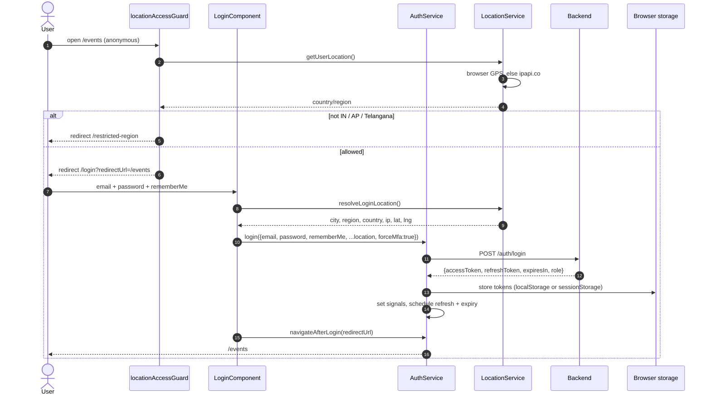

## 2. MFA challenge

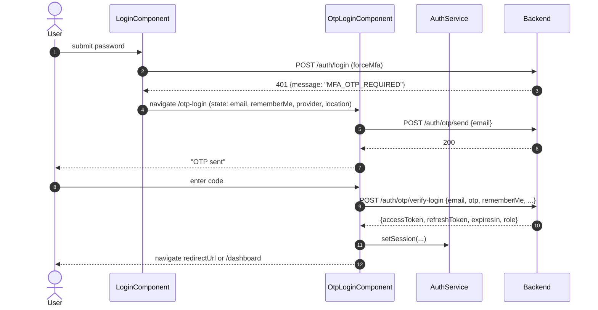

## 3. Token refresh on a 401

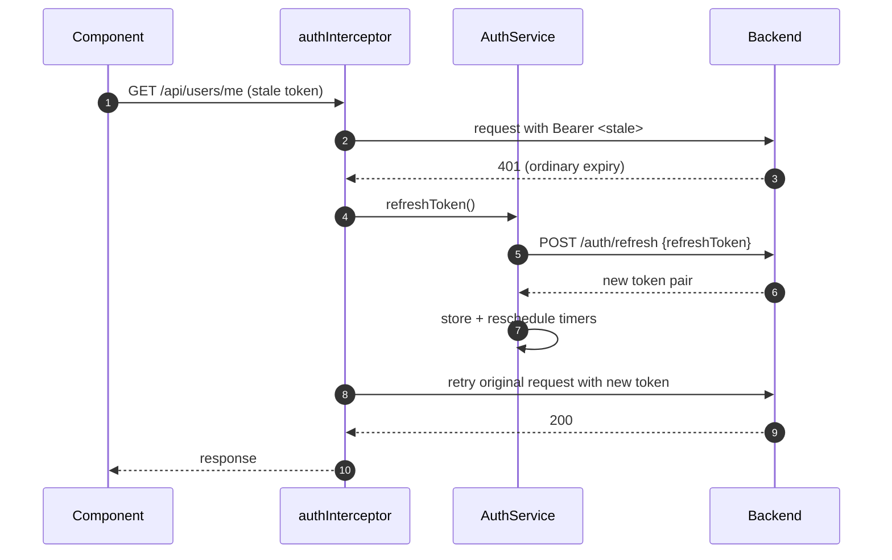

## 4. Superseded session (concurrent login)

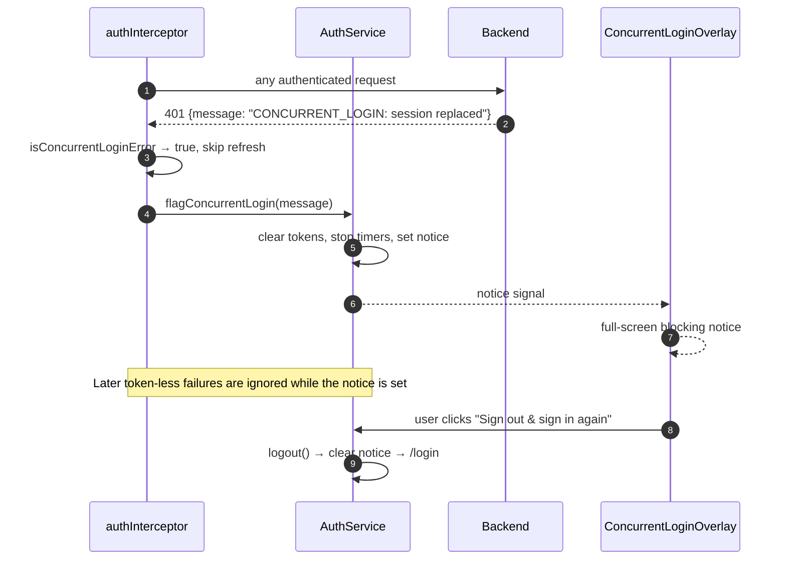

## 5. Create an event with greeting media

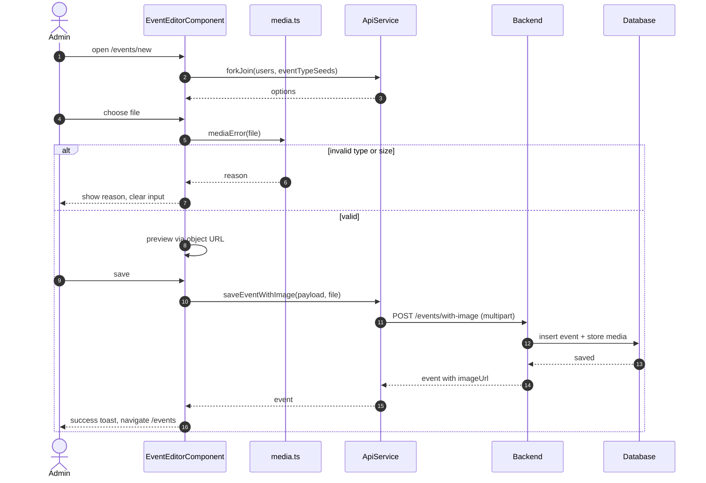

## 6. Calendar month load (per-year festivals)

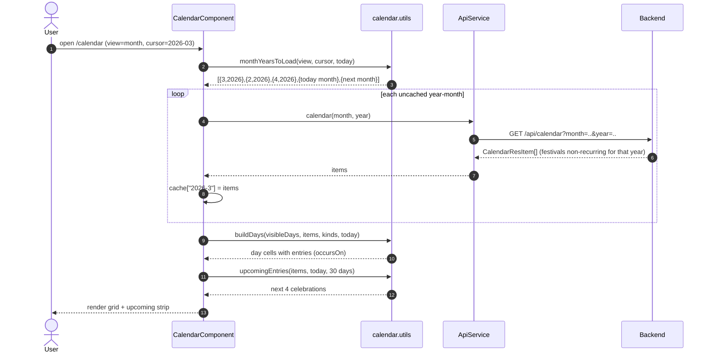

## 7. Send a chat message

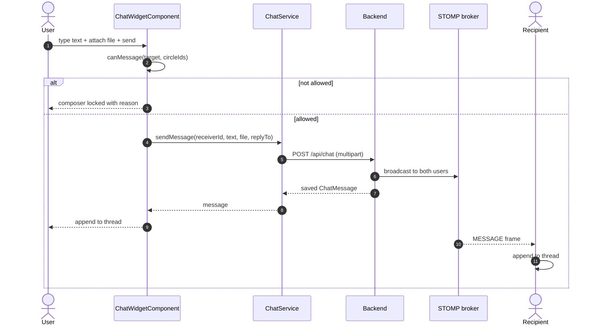

## 8. Publish a notification

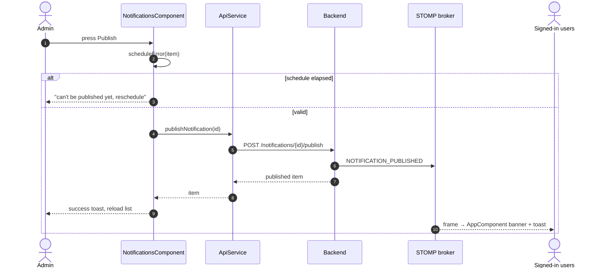

## 9. Impersonation and return

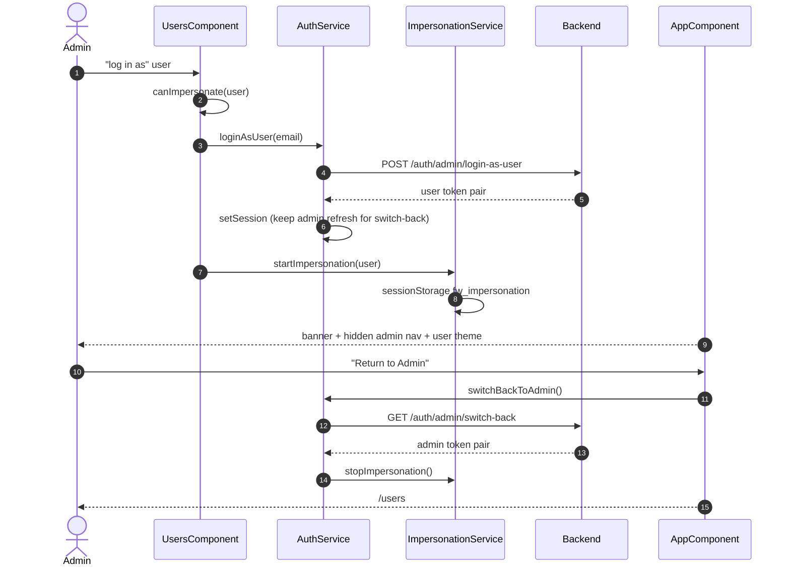

## 10. Connectivity loss and recovery

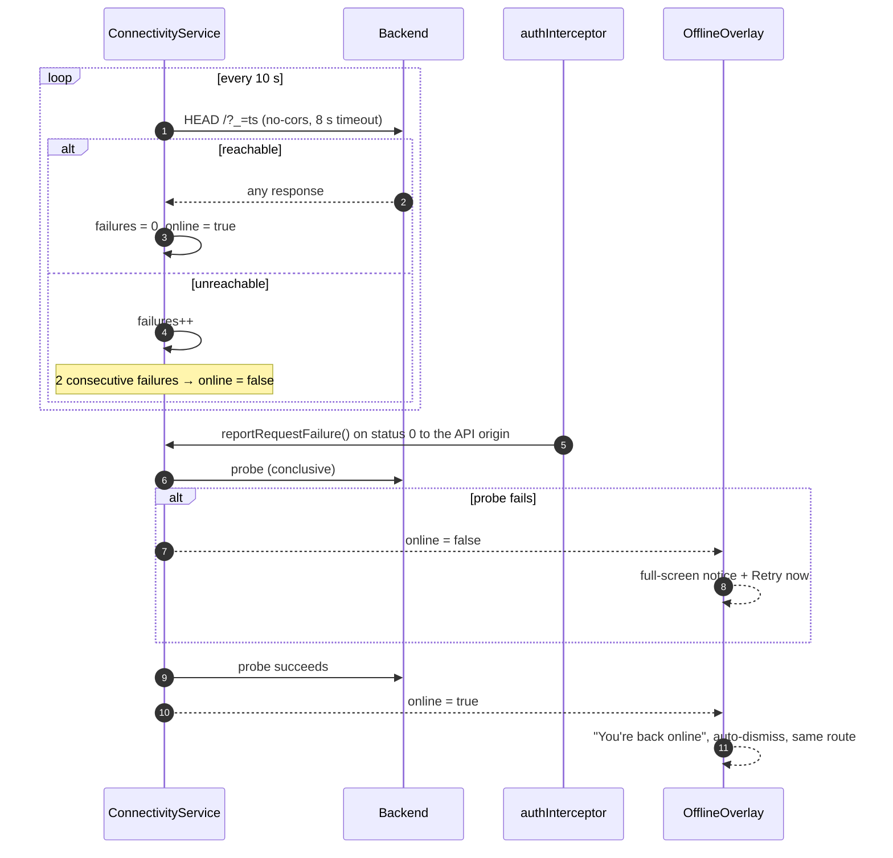

## 11. Retry a failed email

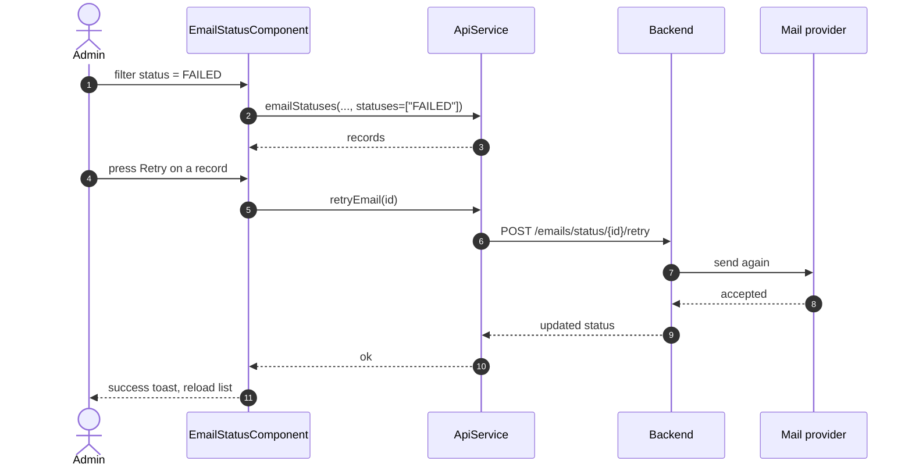

## 12. Location gate denial

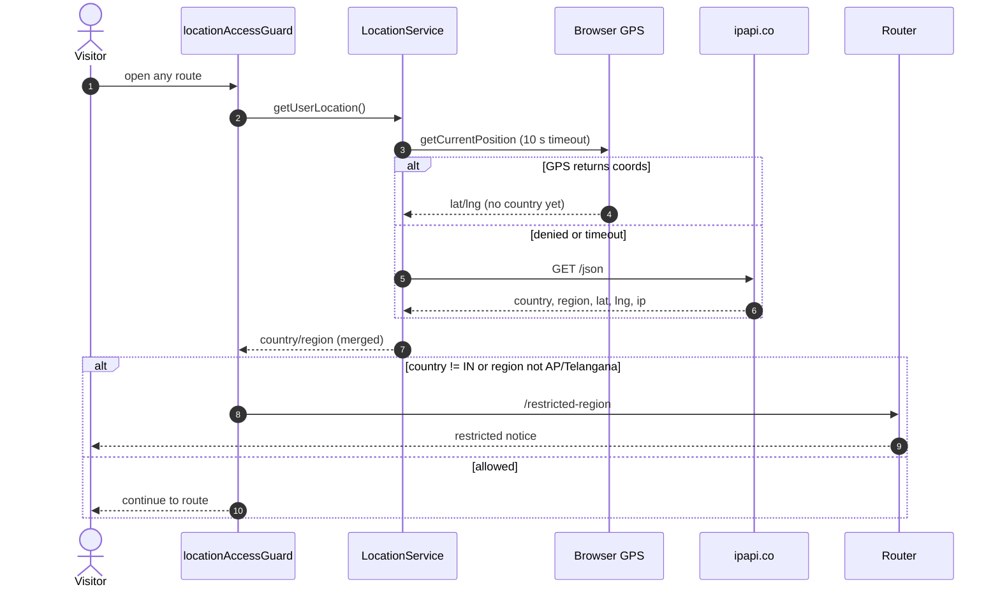
